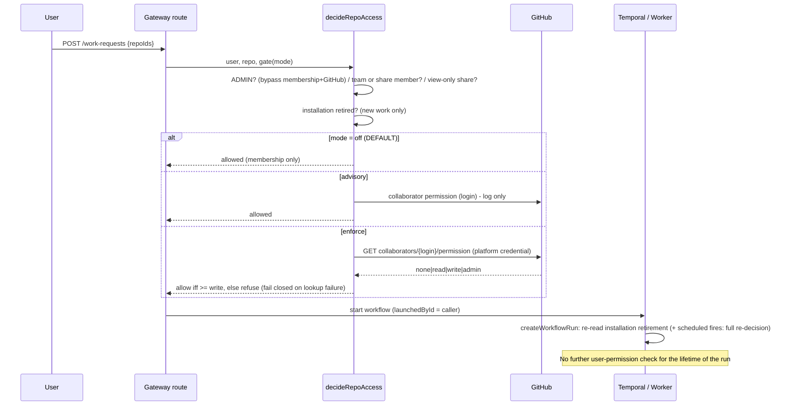
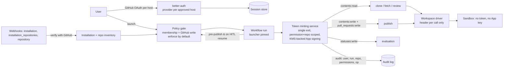

# GitHub Integration Architecture & Security Audit

| | |
|---|---|
| Scope | GitHub identity, App/installation handling, repository authorization, agent credential delivery, Git attribution, GitHub.com + GHES |
| Method | Read-only static review of the repository at `10cbe77`. No workflows were run, no GitHub calls made, no code changed. |
| Evidence convention | `path:line` is verified by reading the source. **[V]** verified in code; **[D]** stated in docs/comments only; **[U]** unverified (needs runtime or GitHub-side evidence). |

> This audit lives under `docs/audits/`, outside the living-doc rules in `CLAUDE.md` §5 (it is a point-in-time review, not a capability reference). Paths below are relative to the repository root.

---

## 1. Executive Summary

**Overall assessment.** The GitHub integration is substantially more mature than a typical agent platform. It is a *platform-credential* design: one operator-registered GitHub App (or PAT) per GitHub host mints short-lived, repository-scoped installation tokens; a separate, optional per-user token path exists for attribution; and GitHub sign-in (identity) is handled by better-auth and never reaches the agent layer. The recurring failure classes in this problem space — credentials on the command line, persisted in `.git/config`, sent to the wrong host, cache collisions across installations, GHES/github.com id collisions, forged webhooks — have each been explicitly designed against and, for the most part, verified in code.

**Major strengths**

1. Installation tokens are minted **per repository** (`repositories: [name]` in the mint body), cached by `installation@apiUrl#scope`, and refused for a host other than the credential set's own (`packages/shared/src/lib/githubInstallation.ts:488-541`, `githubHostScope.ts`).
2. The clone/push credential is **never written to `.git/config`**, is delivered per call as `http.extraheader` through the environment, with hooks/fsmonitor/credential helpers neutralised and stray processes killed first (`packages/worker/src/activities/workspace.ts:215-247`, `:1436-1500`, `:1900-1945`).
3. Webhooks are **HMAC-verified, host-bound, and treated only as a prompt**: installation events re-query GitHub with the App JWT before changing state (`packages/gateway/src/lib/installationWebhook.ts:166`, `docs/github-app-setup.md` §5).
4. Repository access is a **two-key** decision (team membership AND, when enabled, live GitHub collaborator permission), failing closed on lookup failure, with GitHub-login ownership re-verified against the immutable numeric account id (`repoAccessDecision.ts:171-228`, `repoAccessGate.ts:228-323`, `githubIdentityCheck.ts`).
5. Per-user tokens are keyed on `WorkflowRun.launchedById` + `temporalRunId`, not the original requester (`packages/worker/src/lib/runLauncher.ts:36-52`).
6. Auto-merge / default-branch push are fenced by `yarn invariants:check`; git author/committer is a configured bot identity unless launcher attribution is enabled (`packages/worker/src/lib/gitIdentity.ts`).

**Major weaknesses**

1. **The GitHub-permission gate ships `off`**, so by default a team member can drive the platform App to write to a repository their own GitHub account cannot (F-01).
2. **Nothing re-asks GitHub about the user after launch** — queued, deferred, resumed, or long-running runs keep acting under the installation token regardless of the launcher's current GitHub access (F-03).
3. **Installation tokens are not permission-narrowed** (`permissions` omitted), so every agent token carries the App's full set (contents:write, issues:write, statuses:write, actions:read …) (F-04).
4. **GitHub OAuth access tokens are persisted in `accounts.access_token`** with no application-level encryption configured (F-06), while the platform separately encrypts every other credential with AES-256-GCM.
5. **GitHub sign-in is single-instance** (one `github` provider id, one OAuth client) — it cannot sign users in from github.com *and* a GHES instance at once, although repository access supports multiple hosts (F-09).

**Most significant risks** (none rated Critical; no confirmed unauthenticated exploit found): F-01 (High), F-03 (High), F-04 (Medium), F-05 dependency checkouts bypass the launcher's GitHub check (Medium), F-06 plaintext OAuth tokens (Medium).

**Production-enterprise suitability.** *Appropriate with conditions.* The design is sound enough for production enterprise use **provided** operators run `repoAccess.mode = enforce` with the sweep enabled and every user's GitHub login backfilled, and accept the F-03 residual risk. Out of the box (`off`) the platform's authorization model is team-membership-only, which is a weaker guarantee than most enterprises will assume from "GitHub-integrated".

**Single vs. dual App.** Retain the current single-instance-App strategy. A second *Identity* App does not buy meaningful isolation here, because identity never reaches the agent runtime and the dominant risks are policy defaults and token breadth, not App topology (§5). The one second App that is justified — the *approver* App for bot approvals — already exists.

---

## 2. Current Architecture

### 2.1 Components discovered

| Concern | Implementation | Evidence |
|---|---|---|
| Platform GitHub App(s) | One instance App (`GitHubConfig` singleton: appId, private key, client id/secret, webhook secret, default installation id) **per host**, plus per-host sets in `GitHubHostCredential`; an optional second *approver* App (DB-only) | `docs/github-app-setup.md`; `packages/shared/src/lib/githubHostCredential.ts`; `packages/gateway/src/routes/githubApproverApp.ts` |
| Legacy/alt credentials | PAT (`authMode: pat`/`auto` fallback); per-user PATs (`ConnectionCredential`, off by default) | `githubInstallation.ts:493-497,543-545`; `docs/user-github-credentials.md` |
| App JWT | Hand-rolled RS256, `iat=now-60`, `exp=now+600` | `githubInstallation.ts:108-118` **[V]** |
| Installation tokens | `POST /app/installations/{id}/access_tokens`, restricted by repo name, fallback by repo id after rename | `githubInstallation.ts:135-203, 432-467` |
| API client | `@octokit/rest` in the worker (`worker/src/lib/scm/github.ts`); `fetch` in gateway/shared, behind SSRF-guarded fetch | `scm/github.ts:298-307`; `CLAUDE.md` §5 invariants |
| User sign-in | better-auth: built-in `github` provider (github.com) or `genericOAuth` under the same `github` id (GHES) | `gateway/src/lib/githubEnterpriseAuth.ts:197-228`, `betterAuth.ts:203-210,271` |
| Sessions | better-auth cookie sessions (DB `sessions`), in-process validation cache (60 s); PATs and short-lived JWTs for API | `betterAuth.ts`, `gateway/src/plugins/auth.ts:611-628` |
| Installation registry | `GitHubInstallation` rows (admin-registered, `host`+`installationId`), linked to `Connection.installationId` | `routes/githubInstallations.ts:107-150` |
| Webhooks | `POST /api/v1/webhooks/git` (+`/ci`, `/access`); HMAC, per-host secrets, host binding | `routes/webhooks.ts:679-720,1275`; `lib/installationWebhook.ts` |
| Authorization | `authorizeLaunch` → `decideRepoAccess` → `decideRepoLaunch`; `repo_access` projection (sweep + webhook) | `gateway/src/lib/launchAuthorization.ts`, `shared/src/lib/repoAccess{Decision,Gate}.ts` |
| Agent runtime | Docker/K8s workspace; clone with per-call header; `gitAuthed` | `worker/src/activities/workspace.ts` |

One GitHub App serves both the "identity" flow (its client id/secret are the OAuth credentials, `request_oauth_on_install: true` in the manifest, `githubAppManifest.ts:124`) and automation (App JWT + installation tokens). The sign-in scopes requested for GHES are `read:user user:email` (`githubEnterpriseAuth.ts:222`). The approver App is a *second* identity used only for pull-request reviews. **[V]**

### 2.2 Architecture diagram

```mermaid
flowchart LR
  subgraph Browser
    U[User]
  end
  subgraph Gateway["Gateway (Fastify)"]
    BA[better-auth<br/>sessions + OAuth]
    AZ[authorizeLaunch<br/>decideRepoAccess]
    WH[Webhook handler<br/>HMAC + host bind]
    INST[GitHubInstallation<br/>registry - admin only]
    RA[(repo_access<br/>projection)]
  end
  subgraph DB["Postgres"]
    ACC[(accounts<br/>OAuth tokens)]
    CFG[(GitHubConfig / HostCredential<br/>AES-GCM sealed App key)]
    CC[(ConnectionCredential<br/>per-user PAT, sealed)]
    RUN[(WorkflowRun.launchedById)]
  end
  subgraph Worker["Worker (Temporal activities)"]
    SCM[ScmProvider<br/>cloneCredentials / octokitFor]
    TOK[resolveGitHubToken<br/>cache by install@api#repo]
    WS[Workspace driver<br/>gitAuthed]
  end
  subgraph Sandbox["Agent container (untrusted repo code)"]
    AG[Agent + bash tools]
  end
  GH[(GitHub.com / GHES)]

  U -->|OAuth code| BA -->|token exchange| GH
  BA --> ACC
  U -->|launch run| AZ -->|team check + live collaborator perm| GH
  AZ --> RA
  GH -->|signed webhooks| WH --> INST
  WH -->|re-ask GET /app/installations/id| GH
  SCM --> TOK -->|App JWT -> installation token<br/>repositories:[repo]| GH
  CFG --> TOK
  RUN --> SCM
  CC -.->|only if launcher saved token| SCM
  SCM -->|authedCloneUrl| WS
  WS -->|http.extraheader per call,<br/>stray procs killed| GH
  AG -. no credential in env/.git/config .- WS
```

### 2.3 Authentication sequence (user → session)

```mermaid
sequenceDiagram
  participant B as Browser
  participant G as Gateway (better-auth)
  participant GH as GitHub / GHES
  participant D as Postgres
  B->>G: Continue with GitHub
  G->>B: 302 authorize (state; scopes read:user user:email; PKCE off for GHES)
  B->>GH: authorize
  GH->>B: 302 callback?code&state
  B->>G: callback
  G->>GH: exchange code (client id+secret)
  G->>GH: GET /user, /user/emails (GHES: require primary+verified)
  G->>D: upsert User/Account; store accessToken (plaintext) + accountId (host-prefixed on GHES)
  G->>D: hook: syncGithubLoginForAccount -> users.github_login(+_account_id)
  G->>B: Set-Cookie better-auth.session_token (independent of GitHub token)
  Note over G,B: New users isActive=false until admin approves<br/>(or github.signInAutoApproveOrgs)
```
Session cookie lifetime/rotation are **better-auth defaults** (no `session:` block in `betterAuth.ts`) **[V]**. The GitHub token is not returned to the browser **[V — no route returns `accounts.accessToken`; grep of gateway shows only server-side consumers `githubImport.ts:276-320`, `scripts/backfillGithubLogins.ts`]**.

### 2.4 Authorization sequence (launch)



### 2.5 Agent execution sequence

```mermaid
sequenceDiagram
  participant A as Activity (worker)
  participant S as resolveGitHubToken
  participant W as Workspace
  participant C as Agent container
  participant GH as GitHub
  A->>S: runToken(repo): host allowlist -> launcher token? -> platform credential
  S->>GH: mint installation token (repositories:[repo]), cached until exp-60s
  A->>W: createWorkspace(authedCloneUrl)
  W->>W: splitCloneCredential -> cleanUrl + header (token not in .git/config)
  W->>GH: git clone (header via env, hooks disabled)
  W->>C: origin = cleanUrl; no token in container FS/env
  C->>C: agent edits / runs untrusted repo code
  A->>W: gitAuthed("push origin sha:refs/heads/branch")
  W->>C: SIGSTOP/KILL all stray procs; rewrite git config; run git with header from env
  W->>GH: push (App identity), PR via Octokit (worker process, not container)
```

### 2.6 Credential lifecycle

| Credential | Created | Stored | Lifetime / renewal | Reaches agent container? | Revocation |
|---|---|---|---|---|---|
| App private key | Operator | `GitHubConfig`/`GitHubHostCredential`, AES-256-GCM (`CONFIG_ENCRYPTION_KEY`) **[D, `CLAUDE.md` §6]** | Manual rotation | No | Operator; token cache fingerprint (sha256 of key) invalidates on rotation (`githubInstallation.ts:101-106`) |
| App JWT | Per mint | Memory | 10 min | No | — |
| Installation token | Per `(installation, host, repo)` | In-process `Map` (never pruned, `:81`) | 1 h; served until `exp − 60 s` (`:121`); **no mid-activity renewal** | Only as an HTTP header during a `gitAuthed` call; not in container FS | GitHub expiry/uninstall |
| User OAuth token | GitHub sign-in | `accounts.access_token` **plaintext column** (`schema.prisma:1894`) | PAT-style for OAuth Apps (no expiry); GitHub-App user tokens expire 8 h w/ refresh | No (gateway only: login sync, import listing) | Unlink account / cascade delete with user |
| Per-user PAT | User saves | `ConnectionCredential`, sealed | Until removed | Same path as installation token, only for that launcher's runs | User removes; host/origin binding |
| Session | Sign-in | `sessions` + cookie | better-auth defaults | No | Sign-out; 60 s cache lag (`auth.ts:622`) |

---

## 3. Findings

Severity legend: **Confirmed** = reproducible from code reading; **Concern** = design risk with a plausible path; **Hardening**; **Unverified**.

### F-01 — GitHub permission gate defaults to `off`: team membership alone authorizes writes by the platform App
**Severity: High · Type: Confirmed (default configuration) · Complexity: Low (config) / Medium (default flip)**

- **Evidence.** `packages/shared/src/config/registry.ts:1328-1339` (`repoAccess.mode` `defaultValue: 'off'`); `packages/shared/src/lib/repoAccessGate.ts:236-238` (`off` → `gate-off` allowed); `repoAccessDecision.ts:184-227`. `docs/repo-access-gating.md` §1 states the divergence outright.
- **Current implementation.** Launch needs team (or share) membership; GitHub is consulted only under `advisory` (log-only, `repoAccessGate.ts:249-255`) or `enforce`. The run then clones/pushes/opens PRs with the installation token.
- **Implication.** Scenario 1 (user triggers a workflow against a repository they cannot access on GitHub) **succeeds by default**: a team member with only read — or no — GitHub access to a repository the App can write to gets branch + PR creation attributed to the App bot. This is the classic confused deputy. Mitigated partly by the onboarding check (`routes/repositories.ts:579-630`, always on, but it validates the *lead's* read access, not the later launcher's write access).
- **Remediation.** Default to `enforce` for new deployments (seed `advisory` for upgrades with a documented promotion path); make `quickstart`/`env:setup` surface the mode; fail startup health (not just a log, `repoAccessGate.ts:88-97`) when `enforce` and the sweep is disabled.

### F-02 — Platform `ADMIN` bypasses the GitHub permission check (even in `enforce`)
**Severity: Medium · Type: Confirmed design choice · Complexity: Low**

- **Evidence.** `repoAccessGate.ts:240-242`; `repoAccessDecision.ts:209-211`; same bypass for the schedule re-check (`scheduledFireAuthorization.ts:273`) and org membership (`templates.ts:254,257`).
- **Implication.** Any platform ADMIN can drive the App against any repository the installation covers, whatever their GitHub rights. Reasonable for break-glass, but ADMIN is also the role that runs day-to-day operator work; the audit trail is the only control.
- **Remediation.** Make the bypass a setting (`repoAccess.adminBypass`, default true for compatibility); at minimum, write an explicit audit entry whenever the bypass decides a launch (reason `admin` is returned but is it recorded per run? **[U]**).

### F-03 — No re-validation of the launcher's GitHub access after launch
**Severity: High · Type: Concern with confirmed absence of control · Complexity: Medium**

- **Evidence.** Gate is evaluated in gateway launch routes (`launchAuthorization.ts:150`) and, for scheduled fires, in `assertScheduledFireAuthorized` (`scheduledFireAuthorization.ts:262-282`). `templates.ts:611` comment: *"nothing re-asks GitHub at the moment it does"* (deferred channel tasks). `createWorkflowRun` re-reads only installation retirement (`templates.ts:495`). Membership is re-read in some child-run paths (`prdWorkflow.ts:225-250`). No activity re-calls `decideRepoAccess`/`fetchRepoPermission` between steps. **[V by search]**
- **Implication.** Scenario 5 (user loses repository access after queueing) — the run keeps pushing and opening PRs as the App until completion, and a HITL pause can span days. Scenario 6 (installation revoked mid-run) is handled by GitHub itself (tokens die); but *user* revocation, offboarding (`isActive=false`) or team removal are not enforced against in-flight runs.
- **Remediation.** Add a pre-publish gate (immediately before `push`/`createOrUpdatePullRequest` and on HITL resume): re-run `decideRepoLaunch` for the launcher with a short TTL; deny publication, not computation. Cancel/park runs when the launcher is deactivated.

### F-04 — Installation tokens are repo-scoped but not permission-scoped
**Severity: Medium · Type: Confirmed · Complexity: Low–Medium**

- **Evidence.** `githubInstallation.ts:159-172` (body only has `repositories`/`repository_ids`; comment: *"`permissions` is deliberately not narrowed"*). App permissions: `githubAppManifest.ts:38-56` (contents:write, issues:write, pull_requests:write, statuses:write, actions:read, checks:read, members:read).
- **Implication.** Scenario 2 is well mitigated on the *repository* axis (per-repo tokens; cross-repo fallback by id) but every token — including the read-only paths (CI log fetch, permission lookups, listing, `repoPermission`) — carries write on contents/issues/statuses. A bug or prompt-injection that reaches Octokit can write more than the step needs. The agent container never holds the token, which reduces exposure to the worker process.
- **Remediation.** Pass `permissions` per purpose: `{contents:'read'}` for clone-only/review/fetch; `{contents:'write', pull_requests:'write'}` for publish; `{statuses:'write'}` for evaluation. Key the cache on the permission set as well.

### F-05 — Dependency-repo checkouts use platform credentials without checking the launcher's GitHub access
**Severity: Medium · Type: Confirmed gap · Complexity: Medium**

- **Evidence.** `packages/worker/src/lib/repoDependencyContext.ts:183-189` (consent = same team or a `manual` edge), `:233-235` (`cloneCredentials(ref)` per neighbour), org tenant filter `:195-214`; no `decideRepoAccess`/permission call in the file.
- **Implication.** Scenario 2/9 (agent reaches repositories beyond those authorised for its workflow): even in `enforce`, the launcher is only gated for the *target* repository. Up to `MAX_DEPENDENCY_CHECKOUTS` upstream repos are cloned (read-only by convention, not enforcement) and their source is readable by the agent and thus potentially summarised into the PR/model context. The cross-team `manual` edge is team consent, not GitHub consent.
- **Remediation.** Apply `lookupRepoPermission(read)` for the launcher per dependency; mint those tokens with `permissions: {contents:'read'}` (F-04).

### F-06 — GitHub OAuth access/refresh tokens stored unencrypted in `accounts`
**Severity: Medium · Type: Confirmed (config absent) / encryption behaviour of better-auth version [U] · Complexity: Low–Medium**

- **Evidence.** `packages/shared/src/prisma/schema.prisma:1894-1895`; `grep encryptOAuthTokens packages/gateway` → no match; `betterAuth.ts` has no such option. `node_modules` was not installed in the audit environment, so better-auth's default for the installed version could not be inspected **[U]**.
- **Implication.** A DB read (backup leak, SQL injection elsewhere, replica access) yields live GitHub user tokens. Scope is limited (`read:user user:email` for OAuth-App flow), but if the instance's App has user-to-server tokens, `githubImport.ts:297-320` uses the stored token against `/user/installations/{id}/repositories`, and a GitHub-App user token carries the *user's* repository access.
- **Remediation.** Enable better-auth's OAuth token encryption (or wrap with the existing AES-GCM envelope); drop the token after the login sync if it is not needed later; document.

### F-07 — Installation-membership events are not handled (`installation_repositories`), repository removal is detected lazily
**Severity: Medium · Type: Concern · Complexity: Medium**

- **Evidence.** `INSTALLATION_EVENT_TYPES = {installation, installation_target}` (`installationWebhook.ts:50`); no reference to `installation_repositories` anywhere in `packages/*/src` (grep). Lazy path: minting a narrowed token returns 422 → `RepositoryNotVisibleError` (`githubInstallation.ts:133,183-190,432-467`).
- **Implication.** When an org removes a repository from the installation (or flips "all repositories" to "selected"), nothing proactively marks the connection; the failure appears on the next mint (launch, sweep or health probe) as `repo-not-found`. Queued runs fail late; the dashboard may still list the repo as healthy until a probe runs **[U — connectionHealth coverage not traced]**. This also means "repository added" doesn't auto-discover; discovery is by admin import/listing.
- **Remediation.** Handle `installation_repositories` and `repository` events (verify with GitHub exactly as for `installation`), mark `Connection` health, and drop `repo_access` rows. 

### F-08 — Token lifetime margin too small for long activities; one token per activity
**Severity: Low · Type: Confirmed reliability concern · Complexity: Low**

- **Evidence.** `githubInstallation.ts:121` (60 s margin), `:516-519` (cache hit served until `expiresAt`); workspace credential fixed at creation (`workspace.ts:1002` `splitCloneCredential`; the same header is reused for every `gitAuthed`).
- **Implication.** An activity that starts with a cached token having ~61 s left and runs a long TDD loop will fail its push with 401 (GitHub 1-h tokens). It is retried as a transient failure, so impact is flakiness, not exposure. No renewal path exists inside a workspace.
- **Remediation.** Require ≥ 15 min remaining for workspace-bearing activities (separate margin), or re-mint inside `gitAuthed`.

### F-09 — GitHub sign-in supports one GitHub host at a time
**Severity: Medium (for mixed github.com + GHES estates) / Low otherwise · Type: Confirmed limitation · Complexity: High**

- **Evidence.** `githubEnterpriseAuth.ts:197-228` (single `providerId: 'github'`, single `config`), `betterAuth.ts:203-210` (one `resolveGithubSignIn` result), `:601-607` (built-in provider only in `builtin` mode). Host-prefixed account ids are used for GHES (`githubEnterpriseAuth.ts` `fetchGhesUserInfo` → `${hostname}:${id}`) and parsed in `githubIdentityCheck.ts:52`.
- **Implication.** Repository access is multi-host (per-host credentials, per-host webhook secrets) but identity is not: a user on a second GHES host cannot authenticate against it, so for those repositories the gate falls to `no-github-identity` (enforce) or the user-token path. Not a security hole — a capability ceiling — and `githubLoginAccountId` correctly avoids cross-host login collision.
- **Remediation.** Register one `genericOAuth` provider per approved host (`github:<host>`), keep `github` as the default id for back-compat; or accept the limit and document it.

### F-10 — Installation registry is manual; no GitHub-verified binding between a `Connection` and its installation for non-import creation
**Severity: Low · Type: Hardening · Complexity: Low**

- **Evidence.** `routes/githubInstallations.ts:107-150` (ADMIN creates rows without calling GitHub to confirm `installationId`/`accountLogin`); `repositories.ts:436-438,1012` (installation choice ADMIN-only); import path verifies (`verifiedImportInstallation`, `:1274-1296`).
- **Implication.** A wrong/typo'd installation id is caught late (mint 404). The ADMIN-only restriction removes the confused-deputy angle for non-admins; webhook sync (`installationWebhook.ts`) later fixes `accountLogin` from GitHub.
- **Remediation.** On create, call `fetchAppInstallation` and reject mismatches.

### F-11 — Untrusted-repo egress and in-container process model are the remaining credential boundary
**Severity: Informational / Unverified · Complexity: n/a**

- **Evidence.** Credential is delivered only inside `gitAuthed`, after `killStrayProcessesScript` (SIGSTOP×2, SIGKILL; `workspace.ts:462-500`) and with `core.hooksPath=/dev/null`, empty `credential.helper` etc. (`workspace.ts:257-295`). Redaction of secrets in error text: `redactExecError(err, cloneSecrets)` (`:1948`).
- **Residual risk.** The design assumes (a) the container has no `CAP_SYS_ADMIN`/shared PID namespace (comment-level claim, `:462-480` [D]); (b) a process in the container cannot snoop the exec'd `git` before the sweep (the sweep occurs in the same exec, and `-c http.extraheader` is read from the environment, not argv). A same-UID process started by *git itself* (e.g. `core.sshCommand`, `core.pager`, `url.<x>.insteadOf`, includeIf) is the class to test. The rewrite step ("allow-list rewrite") is meant to cover it; not independently fuzzed. **[U — requires adversarial test with a hostile `.git/config` and `.gitattributes` filter drivers]**
- **Remediation.** Keep/extend the adversarial test (hostile repo fixtures: `filter.*.process`, `core.fsmonitor`, `include.path`, `url.*.insteadOf` redirect to attacker host) in the docker test suite.

### F-12 — Commit/PR attribution is bot-only by default
**Severity: Low · Type: Confirmed · Complexity: Low**

- **Evidence.** `registry.ts:429-431` (`git.launcherAttribution` default `none`); `gitIdentity.ts:67-100` (credits launcher only if email verified AND team member); PR created by the App via Octokit (`scm/github.ts:491-527`). Run/launcher linkage in DB: `WorkflowRun.launchedById`, provenance columns (`templates.ts:resolveProvenance`).
- **Implication.** GitHub-side the audit trail ends at "auto-swe[bot]"; mapping to the human requires the platform DB/audit log. That is acceptable and arguably desirable (GitHub's own guidance is that the App is the actor), but enterprises doing GitHub-side audit/Compliance searches cannot tie a commit to a person without the platform. Whether *every* GitHub operation is audit-logged with (user, run, repo, operation) is **[U]**: `docs/audit-log.md` was not traced end to end.
- **Remediation.** Offer `co-author-trailer` as the documented enterprise default; add the run id + launcher id to the PR body footer/commit trailer.

### F-13 — Session revocation lag and default session lifetime
**Severity: Low · Type: Hardening · Complexity: Low**

- **Evidence.** `auth.ts:619-622` (60 s cache; env-tunable `SESSION_CACHE_TTL_MS`); no `session:` config in `betterAuth.ts` so better-auth defaults apply (7 d, daily refresh per library defaults **[U — version not inspected]**).
- **Remediation.** Set explicit `session.expiresIn/updateAge`; ensure account deactivation clears the cache (`invalidateSessionCache`) — likely already true.

### F-14 — Cached tokens survive credential-set removal for up to 1 h
**Severity: Informational · Complexity: Low**

- **Evidence.** `githubInstallation.ts:81-86` (clear only exported for tests/rotation); fingerprint handles key change (`:101-106`) but not an installation *retirement* by the operator or a per-host credential deletion.
- **Remediation.** Clear matching entries when an installation is retired/deleted or a host credential is removed.

### Verified-good controls (not findings)

| Control | Evidence |
|---|---|
| Webhook HMAC with constant-time compare, shape pre-check, 25 MiB body limit | `gateway/src/lib/github.ts:11-43,87` |
| Webhook host binding; instance secret cannot validate another host's delivery | `installationWebhook.ts:72-90`, `routes/webhooks.ts:275-283` |
| Installation webhooks are advisory; state is re-fetched from GitHub with the correct host's App | `installationWebhook.ts:98-130`; `githubInstallation.ts:345-383` |
| Platform credential never sent to a different host family | `githubInstallation.ts:488-492,357-359`; invariants in `CLAUDE.md` §5 |
| Cache key includes installation, API URL and repo scope; key rotation invalidates | `:514-515, 101-106` |
| Installation id validated numeric before URL interpolation | `:154-158, 354-356` |
| Login ownership re-verified by immutable id (rename vs. reassignment) | `githubIdentityCheck.ts`, `repoPermission.ts:235-251` |
| GHES sign-in requires primary **verified** email, host-prefixed account id, no unchecked redirects | `githubEnterpriseAuth.ts:84-135` |
| Account linking trusted-providers excludes email/password (credential planting) | `betterAuth.ts:352-368` |
| Launcher identity keyed on current execution's run id | `runLauncher.ts:36-52` |
| Auto-merge/default-branch push banned by invariant; draft PRs | `CLAUDE.md` §5; `scm/github.ts:491-527` |
| Least-privilege App manifest (no Workflows, no Administration) | `githubAppManifest.ts:38-56`; `docs/github-app-setup.md:361` |

---

## 4. Threat Scenario Analysis

| # | Scenario | Existing mitigations | Missing controls | Exploitability | Impact |
|---|---|---|---|---|---|
| 1 | User triggers workflow on a repo they can't access | Team/share membership; onboarding access check (lead, read); `enforce` gate (write, live, fail-closed) | Gate off by default (F-01); ADMIN bypass (F-02) | **Easy by default** for any team member where mode=off; blocked in `enforce` | PR/branch written by bot into a repo the user can't write |
| 2 | Agent reaches other repos via broad token | Per-repo token; id fallback; host family guard | Permission narrowing (F-04); dependency clones unchecked (F-05) | Low for write; Medium for read of dependency repos | Source disclosure to agent/PR; no cross-repo write |
| 3 | Malicious repo instructions exfiltrate GitHub creds | Token not in container FS/env/`.git/config`; hooks off; process sweep; scanners; egress policy `blocked` modes | Adversarial coverage of git-spawned helpers [U] (F-11); worker holds token in process memory, which is outside the container | Low–Medium; requires a container-escape or git-config trick | Installation token (1 h, one repo, broad permissions) |
| 4 | Compromised container attacks platform-level App creds | Key sealed in DB, only worker/gateway read; Docker via socket-proxy allowlist (`CLAUDE.md` §6); no App key in container | Runtime hardening evidence (caps, seccomp) [U] | Requires escape | App key = all installations' tokens (High if reached) |
| 5 | User loses repo access after queueing | Scheduled fires re-decide; installation retirement re-read at start | Everything else (F-03) | Easy / passive | Continued bot writes after offboarding |
| 6 | Installation revoked mid-run | GitHub invalidates tokens; webhook re-verification retires installation; non-retryable config errors | Proactive repo-level events (F-07); cache clear (F-14) | n/a | Run fails; no escalation |
| 7 | OAuth callback/session takeover | better-auth state/CSRF; trustedOrigins; GHES verified-email only; no email/password linking; `isActive` gate | PKCE off for GHES (`githubEnterpriseAuth.ts:220`, GHES doesn't support PKCE for all versions [U]); built-in github.com PKCE behaviour [U]; auto-link by email across github/google/okta is by design | Low | Account takeover only via IdP-side email trust |
| 8 | Credentials leak via logs/traces/state | `redactSecrets`, `maskCredentialShapes`, CI-enforced `env:` / credential-shape refusal in backends; token not in Temporal history (minted inside activity) | Plaintext OAuth tokens in DB (F-06); activity input does not carry token **[V]** — `authedCloneUrl` is created and consumed within the activity | Low | Token disclosure |
| 9 | Cross-org / cross-instance | Tenant guard (`team.orgId`), host-keyed installation identity `(host,installationId)`, host-prefixed account ids, per-host credentials | Multi-host sign-in absent (F-09) | Low | Isolation holds in code reviewed |
| 10 | Backend component mints over-privileged tokens | JWT only for the host's own App; per-repo mint; `resolveGitHubToken` is the single exit | Any worker/gateway code path can request an *unscoped* token (`repositories` omitted → full installation scope, `:164-166`); no permission narrowing (F-04) | Needs compromised backend | Full installation read/write |

---

## 5. Alignment Assessment

| Principle | Status | Assessment |
|---|---|---|
| User identity authenticated through GitHub | **Partially Aligned** | GitHub (builtin/GHES) + Google + Okta + email/password. Single GitHub host (F-09). Identity binding is robust (immutable account id, verified email on GHES). |
| Application sessions independent of GitHub tokens | **Aligned** | Cookie sessions in `sessions`; GitHub token is only an artifact stored in `accounts` and not used to authorize API calls. Residual: token stored plaintext (F-06). |
| User authorization validated against repo + workflow permissions | **Partially Aligned** | Strong when `enforce`; membership-only by default (F-01); ADMIN bypass (F-02); no post-launch revalidation (F-03). Write is required for launch; read for view/onboarding — operation-differentiated only at launch. |
| Agent identity prefers App installation identity | **Aligned** | Installation token default; PAT supported but secondary; per-user PAT opt-in. |
| Credential scope minimal (repo + operation) | **Partially Aligned** | Repo-minimal; permission-maximal (F-04). Manifest permissions are justified per feature (verified). |
| Credential isolation (user vs. agent) | **Aligned** | User OAuth tokens never in worker clone path; per-user PAT only for the launcher's own runs with host/origin binding. |
| Agent execution isolated from platform secrets | **Partially Aligned** (code Aligned; runtime **Not Verified**) | Design is careful (F-11); container hardening and egress need runtime evidence. |
| Auditability: every operation traceable to initiating user | **Partially Aligned** | DB links run→launcher→repo; GitHub-side attribution is bot-only by default (F-12); end-to-end audit completeness **Not Verified**. |
| GHES compatibility: independent GitHub instances | **Partially Aligned** | Per-host App credentials, installations, webhook secrets, API URLs, id-collision defences (strong); single sign-in host (F-09); GHES version matrix **Not Verified** (API version header fixed at `2022-11-28`, all call sites). |
| Token lifecycle: storage, expiry, renewal, revocation | **Partially Aligned** | Short-lived installation tokens, sealed long-lived secrets, rotation fingerprint; no mid-run renewal (F-08), cache not cleared on retirement (F-14), plaintext OAuth tokens (F-06). |
| Least privilege across users/services/agents | **Partially Aligned** | Strong repo and host scoping, role-gated settings; permission narrowing and admin bypass remain. |

---

## 6. Architecture Alternatives

### Option 0 — Current: one App (per host) + optional per-user PAT + optional approver App

| | |
|---|---|
| Pros | Simple operations; one private key per host; manifest flow automates creation; sign-in and automation share installation lifecycle; already supports GHES per-host sets. |
| Cons | Identity and automation share an OAuth client; installation tokens carry full App permissions; sign-in single-host. |
| Security | Identity never reaches the agent runtime, so sharing the App for sign-in is low-risk. The client secret is separate from the private key and from installation tokens. |

### Option 1 — Single App, hardened (recommended)

Same topology, plus: per-purpose `permissions` on every mint (F-04), a mandatory pre-publish re-validation (F-03), `enforce` default (F-01), token-minting isolated to one narrow service (the worker `resolveGitHubToken` exit is already the single choke point), and encrypted OAuth tokens (F-06).

| | |
|---|---|
| Pros | Addresses every confirmed finding without new Apps; no org re-installation; no migration of installations/webhooks. |
| Cons | App private key still unlocks all installations if the minting host is compromised (mitigate with KMS/HSM-backed signing or a signing sidecar, P2). |
| Complexity | Low–Medium |

### Option 2 — Dual App: Identity App + Automation App

| Dimension | Assessment |
|---|---|
| Blast radius | Identity App compromise yields only sign-in/user-to-server capability (can't mint installation tokens). Today the OAuth client secret already cannot mint installation tokens — the private key is the dangerous secret and is *the same* in both designs. Marginal gain. |
| Least privilege | Identity App can request *no* repository permissions (only account `Email addresses: read`, optional `Members`). Automation App never needs `request_oauth_on_install`. Real but small. |
| User-token capability | A GitHub-App *user* token (user-to-server) is what lets you ask `GET /user/installations/{id}/repositories` and perform actions as the user, with expiry + refresh. Today's sign-in is an OAuth-App-style flow (`read:user user:email`); a dedicated Identity App would make that capability first-class for permission checks, replacing collaborator lookups by login. This is the one genuine functional upside. |
| Keys/secrets | Two key sets per host, two webhook configs, two rotations. For GHES, ×N hosts. |
| Org install requirements | Org admins install two Apps (or the Identity App only needs to be *authorised* by users, not installed, if no permissions requested). |
| GHES | User-to-server tokens, installation-repositories listing and the `X-GitHub-Api-Version` header are version-dependent; two Apps double the per-host version risk. |
| Operations / DX | Higher; manifest flow must be doubled; docs and `GitHubHostCredential` shape change. |
| Migration | New table/columns for identity App credentials; re-link accounts (providerId change) or run both; users re-authorize. Medium–High. |

**Verdict.** The current threat model does **not** justify Option 2 now. The risks found are default policy (F-01), missing post-launch checks (F-03), token breadth (F-04) and token storage (F-06) — all orthogonal to App count. Revisit Option 2 if the platform moves to *user-to-server* permission checks (replacing the login-based collaborator lookup) or needs the Identity App to be installable by org members without org-admin involvement.

---

## 7. Recommended Target Architecture



- **Apps.** One instance App per GitHub host (as today) + the existing optional approver App. Add an Identity App only if user-to-server tokens become required (§6).
- **User authentication.** Keep better-auth; add one provider per approved GHES host; store tokens encrypted or discard after login sync; explicit session TTLs.
- **Repository permission verification.** `enforce` default; `write` required to launch, `read` to view; re-check at publish and at HITL resume; honour the dependency repos (F-05); consider replacing login lookup with user-to-server `GET /user/installations/{id}/repositories` if an Identity App is adopted.
- **Installation tokens.** Always `repositories:[…]` **and** `permissions:{…}` per step; cache keyed on both; ≥15 min lifetime floor for workspace activities; clear on retirement.
- **Agent credentials.** Unchanged principle (token only in the per-call git environment, never in the container or model context); add adversarial test coverage.
- **Execution permission enforcement.** A step-level allowlist of GitHub operations (clone, push to the run's branch, PR create/update) mapped to token permission sets; deny anything else at the SCM provider seam.
- **GHES configuration.** Per host: web URL, API URL, App credentials, webhook secret, OAuth provider, `github.repositoryHosts` approval, optional pinned API version with a documented minimum GHES release.

---

## 8. Prioritized Remediation Roadmap

| Pri | Item | Benefit | Complexity | Dependencies | Compatibility impact |
|---|---|---|---|---|---|
| **P0** | Make `repoAccess.mode=enforce` the default for new installs; add a startup health failure when enforcing without sweep/logins; document the promotion path (F-01) | Closes the default confused-deputy | Low | Login backfill script, sweep enabled | Users without a linked GitHub login are refused until they link |
| **P0** | Pre-publish + HITL-resume re-validation of the launcher (F-03); cancel on user deactivation | Enforces the stated property during long runs | Medium | `decideRepoLaunch` reuse; Temporal activity | Extra GitHub call at publish; new refusal path mid-run |
| **P1** | Per-purpose `permissions` on installation tokens + cache key (F-04) | Real least privilege; limits blast radius | Low–Medium | Audit of every `octokitFor` caller | Mint returns 422 if the App lacks a requested permission |
| **P1** | Launcher check + read-only tokens for dependency checkouts (F-05) | Closes cross-repo read gap | Medium | F-04 | Some dependency clones disappear for users lacking access |
| **P1** | Encrypt or drop `accounts` OAuth tokens (F-06) | Removes plaintext user tokens at rest | Low–Medium | better-auth config + key mgmt; data migration to re-encrypt existing rows | Existing rows need one-time migration |
| **P1** | ADMIN-bypass setting and audit entry (F-02) | Operator control + traceability | Low | — | Default unchanged |
| **P2** | Handle `installation_repositories` / `repository` events; health on removal (F-07); clear cache on retirement (F-14) | Prompt, accurate drift detection | Medium | Webhook verification path | None |
| **P2** | Multi-host sign-in providers (F-09) | Parity with multi-host repo access | High | better-auth provider-per-host; account id scheme exists | `github` id preserved for the default host |
| **P2** | Token lifetime floor / in-workspace re-mint (F-08) | Removes flaky late pushes | Low | — | None |
| **P2** | Validate installation on admin create (F-10); explicit session TTLs (F-13) | Early error; hygiene | Low | — | None |
| **P2** | KMS/HSM-backed App signing or signing sidecar | Reduces blast radius of host compromise (Scenario 4/10) | Medium–High | Infra | Deployment changes |
| **P3** | `co-author-trailer` default and run/launcher footer on PRs (F-12) | GitHub-side traceability | Low | `git.launcherAttribution` | Commit message format |
| **P3** | Adversarial hostile-repo test suite for `gitAuthed` (F-11) | Regression-proof the main boundary | Medium | Docker CI job | None |
| **P3** | Dedicated Identity App + user-to-server permission checks | Replaces login lookup, user-token expiry | High | Option 2 migration | Re-authorization |

---

## 9. Open Questions and Verification Gaps

1. **better-auth behaviour for the installed version** (token encryption default, session defaults, PKCE for the built-in GitHub provider, state storage). `node_modules` was absent; inspect `better-auth/dist` and `GET /api/auth/*` behaviour in a running instance.
2. **Production values of `repoAccess.mode`, `repoAccess` sweep enablement, `github.userCredentialsEnabled`, `github.repositoryHosts`, `git.launcherAttribution`.** Needs `/admin/platform-settings` export.
3. **Which GitHub App(s) are actually registered and their granted permissions/subscribed events vs. the manifest** (e.g. did org admins accept new permissions; is `Members: read` granted; is "Only selected repositories" used). Needs GitHub-side settings screenshots or `GET /app` + installation payloads.
4. **Whether the OAuth client used for sign-in is the App's client id/secret or a separate OAuth App** (determines whether user-to-server tokens exist and what `/user/installations/{id}/repositories` returns).
5. **GHES versions in scope** and their support for: fine-grained `permissions` in token mint, `installation_repositories` events, `X-GitHub-Api-Version: 2022-11-28`, collaborator permission semantics (custom roles map to `read/write/admin` differently), PKCE on the authorize endpoint.
6. **Worker/Sandbox runtime hardening** (container capabilities, seccomp, user namespaces, pid namespace sharing, egress policy actually enforced, K8s `kubectl exec` audit-log exposure) — requires deployed-environment evidence and a hostile-repo test run.
7. **Audit-log completeness**: does every push/PR/comment/merge-enablement write an audit row with (user, run, repo, operation)? Trace `lib/auditLog.ts` call sites and verify against `docs/audit-log.md`.
8. **Behaviour of custom repository roles and rulesets**: collaborator `permission` returns `none/read/write/admin` only (maintain/triage are folded); the platform cannot distinguish `maintain`. Branch protection/rulesets are enforced by GitHub against the App identity — whether the App is on bypass lists is a GitHub-side setting.
9. **Rate-limit behaviour** of the permission lookup at sweep scale on large GHES instances.
10. **Tests missing/to add** (from the test inventory in `packages/shared/src/lib/*.test.ts`): (a) a launch → queue → permission-revoked → publish integration test; (b) a token-mint test asserting `permissions` in the body; (c) dependency-checkout authorisation; (d) `installation_repositories` delivery; (e) a hostile `.git/config` fixture against `gitAuthed`; (f) a test that `accounts.access_token` is not stored in plaintext.

---

*Prepared as a read-only assessment; no remediation was implemented. Where a conclusion rests on comments or documentation rather than executed code it is labelled **[D]**; where it needs runtime or GitHub-side evidence it is labelled **[U]**.*
