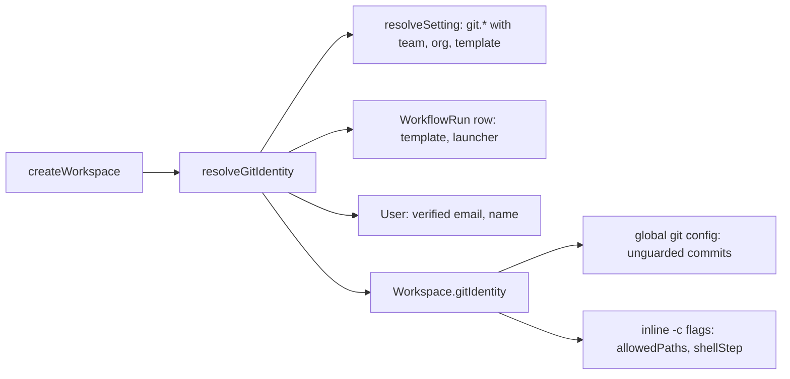

# Whitelabel-lite: configurable git author and support info

Jira: N/A
Date: 2026-10-23
Status: Approved
Last reviewed: 2026-10-23

## Problem

An operator who deploys auto-swe inside a company cannot adapt two things that users and reviewers
see every day.

1. **Git author.** Every commit the platform makes carries the author `auto-swe <auto-swe@localhost>`.
   The value is a string literal in four places. The address is not real, so GitHub links the commits
   to no account. Teams cannot use their own bot identity, and nobody can tell which person launched
   a run from the commit history.
2. **Support contact.** The web app shows no way to reach whoever operates the deployment. A user who
   hits an error or a locked account has no contact to use.

Product name, logo, accent color and outbound wording are not part of this change.

## Approach

**Git author:** three registry settings in a new `git` group. They resolve through the existing
scope cascade `WORKFLOW_TEMPLATE → TEAM → ORGANIZATION → GLOBAL`. A new worker helper resolves them
once when a workspace is created. The result travels on the `Workspace` object so the hardened
commit paths use it too.

**Support info:** three optional environment variables on the web container. The root layout reads
them on each request, validates them, and passes them to the browser in `window.__APP_CONFIG__`.

Alternatives discarded:

- **Per-agent identity.** Agents never run `git commit`. Fixed platform code makes every commit. An
  `Agent` row would need a version bump for a non-behavioral field, and several personas share one
  workspace.
- **Support info in the registry.** The login page would need an unauthenticated read of settings or
  a gateway call during rendering. The web container has no database access.

## Design

### Git identity

Three settings, group `git`. All use `overridableAt: ['WORKFLOW_TEMPLATE', 'TEAM', 'ORGANIZATION']`,
`requiredRole: 'LEAD'`, `runPinned: false`, `restartRequired: false`.

| Key | Default | Schema |
|---|---|---|
| `git.authorName` | `auto-swe` | 1–100 chars, no control characters, no `<` or `>` |
| `git.authorEmail` | `auto-swe@localhost` | up to 254 chars, one `@`, no whitespace, no control characters, no `<` or `>` |
| `git.launcherAttribution` | `none` | enum `none`, `co-author-trailer`, `author` |

The email schema is a custom pattern, not `z.email()`. The default `auto-swe@localhost` has no top
level domain, so `z.email()` would reject the default itself.

A new `lib/gitIdentity.ts` in the worker exports `resolveGitIdentity(scope)`. It builds the setting
context and returns a `GitIdentity`:

```ts
interface GitIdentity {
  committer: { name: string; email: string }; // the configured bot identity
  author: { name: string; email: string };    // equals committer unless mode is `author`
  coAuthorTrailer?: string;                   // only in `co-author-trailer` mode
}
```

**Scope context.** `createWorkspace` already receives `{ teamId }` and all ten callers pass
`repo.teamId`. The helper adds the rest:

- `orgId` comes from `Team.orgId`.
- `workflowTemplateId` and `launchedById` come from the `WorkflowRun` row of the current execution.
  A sibling of `currentRunLauncherId()` in `runLauncher.ts` reads them and applies the same
  `temporalRunId` check, so a re-run never reads a stale row.
- Outside a workflow run (eval harness, standalone gate runner) there is no template and no launcher.
  The helper resolves from the team, organization and global tiers and uses no attribution.

A database failure throws. The activity retries. It never commits under a fallback identity.

**Launcher attribution.**

| Mode | Author | Committer | Trailer |
|---|---|---|---|
| `none` | configured | configured | none |
| `co-author-trailer` | configured | configured | `Co-authored-by: <launcher name> <launcher email>` |
| `author` | launcher | configured | none |

The launcher email is `User.email`. The launcher name is `User.name`, or the email address when the
name is empty. Attribution applies only when `User.emailVerified` is true. GitHub credits a commit to
the account that owns the author email, so an unverified address could credit a commit to someone
else. When the launcher is unknown, has no verified email, or the run started from a webhook or a
schedule, the helper uses the configured identity and adds no trailer. The helper strips control
characters and angle brackets from the launcher name before it reaches a trailer or a git flag.

**Carrying the identity.** `Workspace` gains a `gitIdentity` field. Three kinds of site consume it:

1. `createWorkspace` replaces the two literal `git config --global` calls with a `shellQuote`d helper
   that writes `user.name`, `user.email`, `author.name`, `author.email`, `committer.name` and
   `committer.email`. The unguarded commit sites, such as `decomposition.ts`, read this global
   config and need no change.
2. The hardened paths ignore global config on purpose. `allowedPaths.ts` and `shellStep.ts` replace
   their literal `-c user.name=… -c user.email=…` strings with the same flags built from the
   workspace identity. A shared `gitIdentityFlags(identity)` builds both forms.
3. A helper appends the trailer to the commit message text at each platform commit site:
   `commitStaged`, `finalizeScript`, `decomposition.ts` and `commitTrustedTree`. It does not use
   `git commit --trailer`, which needs git 2.32 or newer, and executor images vary.

If a caller passes a workspace-like object without `gitIdentity`, such as a test fake, the sites fall
back to the default identity.



### Support info

Three optional variables: `NEXT_PUBLIC_SUPPORT_URL`, `NEXT_PUBLIC_SUPPORT_EMAIL`,
`NEXT_PUBLIC_SUPPORT_SLACK`. The prefix follows the existing `NEXT_PUBLIC_TEMPORAL_UI_URL` and
`NEXT_PUBLIC_GRAFANA_URL` convention. Only server code reads them, in `lib/env.ts`, so Next never
inlines them into the client bundle. The layout stays `force-dynamic`.

A `supportInfo()` function validates each value and drops what fails:

- URL: parses as `https:`. Anything else, including `http:` and `javascript:`, is dropped.
- Email: one `@`, no whitespace, no `<` `>` or quotes. It renders only as a `mailto:` link.
- Slack: free text up to 80 characters. A value that parses as `https:` renders as a link. Anything
  else renders as text, for example `#platform-help`.

The layout adds a `support` object to `__APP_CONFIG__`. Its existing escaping of `<`, `>` and `&`
applies. Values render as React text or as an `href`. No value goes through `dangerouslySetInnerHTML`.

A `useSupportInfo()` hook feeds one `SupportContact` component. It appears on:

- the login page,
- `error.tsx` and `not-found.tsx`,
- the sidebar footer (a small "Support" block),
- `global-error.tsx`, on a best effort basis. That screen replaces the root layout, so it shows the
  block only if `window.__APP_CONFIG__.support` already exists.

When no variable is set, the component renders nothing, with no empty block or heading.

The web service in `docker-compose.app.yml` and `docker-compose.prod.yml` has no `env_file`. Each
variable needs an explicit line there, or the container never sees it. `.env.example` documents all
three as optional.

## Acceptance Criteria

**Settings**

1. The system shall define `git.authorName` (default `auto-swe`), `git.authorEmail` (default
   `auto-swe@localhost`) and `git.launcherAttribution` (default `none`) in group `git`, overridable at
   `WORKFLOW_TEMPLATE`, `TEAM` and `ORGANIZATION`, with `requiredRole` `LEAD` and `runPinned` false.
2. If a write sets `git.authorName` to an empty string, a string over 100 characters, or a string
   containing a newline, `<` or `>`, then the system shall reject it with HTTP 400.
3. If a write sets `git.authorEmail` to a value with no `@`, with whitespace, with `<` or `>`, or over
   254 characters, then the system shall reject it with HTTP 400.
4. The system shall accept `auto-swe@localhost` as a valid `git.authorEmail`.
5. If a write sets `git.launcherAttribution` to a value other than `none`, `co-author-trailer` or
   `author`, then the system shall reject it with HTTP 400.

**Resolution**

6. When no override exists at any scope, the system shall create workspaces whose commits have author
   and committer `auto-swe <auto-swe@localhost>`.
7. When a TEAM override sets name N and email E and a workspace is created for a repository of that
   team, the system shall give author and committer N and E.
8. When both a WORKFLOW_TEMPLATE override and a TEAM override exist, the system shall use the template
   value. When a TEAM and an ORGANIZATION override exist and no template override exists, the system
   shall use the team value.
9. When the repository's team belongs to an organization with an ORGANIZATION override and no
   narrower override exists, the system shall use the organization value.
10. If the settings read fails with a database error, then the activity shall fail with a retryable
    error and the system shall not commit under a fallback identity.

**Launcher attribution**

11. While `git.launcherAttribution` is `none`, the system shall add no trailer and use the configured
    identity as author and committer.
12. While the mode is `co-author-trailer` and the launcher has a verified email, the system shall end
    every platform commit message with a blank line and `Co-authored-by: <name> <email>`, and keep the
    configured identity as author and committer.
13. While the mode is `author` and the launcher has a verified email, the system shall set the commit
    author to the launcher and keep the configured identity as committer.
14. If the launcher is unknown, has `emailVerified` false, or the run started from a webhook or a
    schedule, then the system shall use the configured identity with no trailer in every mode.
15. When the launcher name contains a newline, `<` or `>`, the system shall strip those characters
    before it writes the trailer or the author flag, so no extra trailer line is possible.

**Commit sites**

16. When `finalizeScript` receives an identity other than the default, the system shall produce a
    script that contains that identity and does not contain the literal `user.name='auto-swe'`.
17. When the guarded `commitStaged` path runs with a workspace identity, the system shall pass that
    identity in its `-c` flags.
18. When the name is `O'Brien`, the system shall create a commit whose author name is `O'Brien`, with
    no shell error and no extra command run.

**Support info**

19. When `NEXT_PUBLIC_SUPPORT_URL` is `https://help.example.com/x`, the login page, the error page,
    the not-found page and the sidebar footer shall each render a link with that `href`.
20. If `NEXT_PUBLIC_SUPPORT_URL` is `http://…`, `javascript:…` or not a URL, then the system shall
    render no support link and shall not fail.
21. When `NEXT_PUBLIC_SUPPORT_EMAIL` is `help@example.com`, the system shall render a `mailto:` link.
    If the value is invalid, the system shall render nothing for it.
22. When `NEXT_PUBLIC_SUPPORT_SLACK` is `#platform-help`, the system shall render it as text. When it
    is an `https:` URL, the system shall render a link. If it is longer than 80 characters, the system
    shall drop it.
23. While no support variable is set, the system shall render no support element, heading or empty
    container on any page.
24. While `window.__APP_CONFIG__.support` is absent, `global-error.tsx` shall render without a support
    block and without throwing.
25. The system shall pass all three support variables to the web service in `docker-compose.app.yml`
    and `docker-compose.prod.yml`, and `.env.example` shall document them.

## Out of Scope

- Product name, logo, favicon, accent color and the `auto·swe` wordmark.
- Outbound wording: the PR footer, the agent-run footer, emails, Slack text, the MCP server name.
- The `User-Agent` sent to GitHub.
- Wire identifiers: `X-AutoSwe-Signature`, `autoswe-v1`, `ats_`, workflow IDs, localStorage keys and
  telemetry names.
- Per-agent git identity.
- Per-team support contacts.
- GitHub noreply addresses for the launcher.
- Rebranding the in-app `/docs` content.

## Risks & Open Questions

- **Privacy. Needs a decision by the operator, not by code.** `author` and `co-author-trailer` write a
  person's account email into the target repository history for good. The default `none` avoids this.
  Document the effect in `docs/configuration.md`. Resolved: the default is `none`.
- **Forged attribution.** An unverified account email could credit commits to another GitHub user.
  Resolved: attribution requires `emailVerified`.
- **Mixed authors in one run.** The identity resolves per workspace and is not pinned. A setting
  edited during a long run can give one pull request two authors. Resolved: accepted. `runPinned` can
  be turned on later.
- **Runs outside a workflow.** Evals and standalone gate runners have no template or launcher. They
  resolve from the team tier upward. Resolved: accepted.
- **Hardened paths.** The two guarded commit paths ignore global config. A missed site would commit as
  `auto-swe` and no test would fail unless it checks the identity. Resolved: criteria 16 and 17 cover
  both sites. A repository search for `auto-swe@localhost` must find only the default constant.
- **Detection by author.** A search found no code that recognises platform commits by author name or
  email. Resolved.
- **Group registration.** Resolved: no web label map names the groups. The group is added to
  `SETTING_GROUPS` and the drift check confirms it.
- **Trailer and author support in old git.** Resolved: the trailer is part of the message text, so it
  needs no git feature. The `author.name` and `author.email` config keys need git 2.22 or newer.
  Criterion 13 is checked on the default executor image by the Docker-backed test.
- **Feature flag.** Not warranted. Defaults reproduce today's behavior exactly, and support info is
  hidden until set.

## Testing

- **Unit, shared:** registry schema tests for criteria 1–5, including the `auto-swe@localhost` default
  and the settings integrity test for group prefixes.
- **Unit, worker:**
  - `gitIdentity.test.ts` for criteria 6–15 with a mocked Prisma client and `resolveSetting`.
  - `finalizeScript` and `commitStaged` tests for criteria 16–17.
  - A `shellQuote` test for criterion 18.
- **Docker, opt-in:** one real commit in a workspace container for each mode, reading the author,
  committer and trailer back with `git log --format=%an%n%ae%n%cn%n%ce%n%B`. Name the file on a
  `yarn test` line in `ci.yml` as the invariants check requires.
- **Unit, web:** `supportInfo()` validation tests, `SupportContact` render tests for criteria 19–24,
  and an update to the layout test for the `__APP_CONFIG__` shape.
- **Static:** a test or script check for criterion 25. Run `yarn docs:check`, `yarn invariants:check`
  and `yarn env:setup check`.
- **Manual:** set a team override in `/admin/platform-settings`, run a work request, and confirm the
  pull request commits show the configured author.
