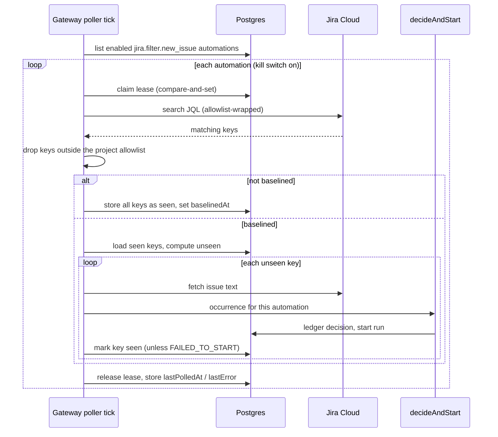

# Jira filter polling automation

Jira: N/A
Date: 2026-10-27
Status: Approved
Last reviewed: 2026-10-27

## Problem

The platform can start a run from a Jira ticket only when Jira pushes a transition webhook. That path has no ticket-to-repository mapping, so it works only when exactly one repository is onboarded. It also cannot select tickets by a Jira filter.

Teams want to name a Jira filter (a JQL query) and a repository, and have every new matching ticket start a run on that repository. Many repositories will use this, each with its own filter and template.

## Approach

Add a new event source, `jira.filter.new_issue`, to the existing automation engine. A poller in the gateway runs each enabled automation's JQL on a schedule. Each issue key the automation has not seen before becomes one occurrence. The engine decides it and starts the run, with the same ledger, caps, budget checks and kill switch as every other source.

The source targets a repository. One automation holds one JQL, one repository and one template, so many repositories means many automations. The template is configurable per automation, as for every event automation.

Discarded alternatives:

- **A worker activity on a Temporal Schedule.** This matches the run-reaper pattern, but the engine and `launchTrackedWorkflow` exist only in the gateway. The worker would need a new privileged gateway route.
- **An external poller posting to `inbound.event`.** This works without platform code, but it adds a component to run and secure, and it cannot enforce a project allowlist.

## Design

### Source descriptor

`jiraFilterNewIssueSource` in `packages/shared/src/automation/sources/jiraFilter.ts`, registered beside the other sources.

| Part | Value |
|---|---|
| `key` | `jira.filter.new_issue` |
| `target` | `repository` |
| Filters | `{ jql: string }`, 1–2000 characters, trimmed |
| Facts | `issueKey`, `summary`, `description` (at most 4,000 characters), `url`, `projectKey` |
| `mismatch` | Always `null`. The JQL already selected the issue, and the descriptor cannot evaluate JQL |
| Subject and scope | Both `jira-<key>`, lowercased. One run is enough per ticket. Cooldown never links two tickets |
| `dedupeKey` | `<ownerKey>#jira-<key>`, lowercased |
| Workflow id | `jirapoll-<automation8>-<key>`. It differs from the Jira webhook's `jira-<ticket>` |
| Default template | `ticket-to-merge`. The automation's `templateId` overrides it |
| Run ticket | The real Jira key, not a synthetic one, so `gatherTicketContext` and tracker sync work |
| Run description | The key and the link first, then the summary and description inside an explicit untrusted block (`<ticket>…</ticket>`), with a line that tells the agent to treat it as data. A `</ticket` inside the text is escaped |
| In-flight look-back | 14 days, as for issue labels |
| Kill switch | `workflow.jiraPollAutomationsEnabled` |
| `actor` | None. The run uses the platform credential, as CI-failure runs do |

The form needs a multi-line text field. `FilterField` gains `kind: 'text'`, and the editor renders it as a textarea.

### Settings (registry)

| Key | Default | Scope | Role | Purpose |
|---|---|---|---|---|
| `workflow.jiraPollAutomationsEnabled` | `false` | team, organization | ADMIN | Kill switch. While off, the poller does not call Jira for that team's automations |
| `workflow.jiraPollProjectKeys` | `[]` | global, team, organization | ADMIN | Jira project keys a polling automation may read. Empty means nothing matches |
| `workflow.jiraPollIntervalSeconds` | `300` | global only | ADMIN | Seconds between ticks. Minimum 60. Read at every tick, so no restart is needed |

### Poller

`packages/gateway/src/lib/automations/jiraPoller.ts` holds the logic. A gateway plugin starts a self-rescheduling `setTimeout` chain, not `setInterval`, so a slow tick cannot overlap the next one in the same process. The plugin starts only when the tracker provider is Jira and is fully configured.

Replicas do not run an advisory lock. Prisma's connection pool does not keep session locks, so the poller uses a lease column instead. Before polling one automation, it runs `updateMany` on that automation's poll-state row where `leaseUntil` is null or in the past, and sets `leaseUntil` five minutes ahead. A count of one means this replica owns the poll. The lease is released at the end of the poll, and it expires on its own if the process dies.

Per automation, one poll does the following:

1. Skip it if the repository is inactive, its installation is retired, or the kill switch is off for its team.
2. Resolve the allowlist for the repository's team. If it is empty, record `lastError = NO_ALLOWED_PROJECTS` and stop.
3. Search with `project in (<allowlist>) AND (<jql>)` through `POST /rest/api/3/search/jql`, requesting only `summary` and `project`. Page until done, up to 1,000 matches. If there are more, record `lastError = FILTER_TOO_BROAD` and act on none of them.
4. Drop every returned issue whose `project.key` is not in the allowlist. **This result check is the authoritative control.** The query wrapper only narrows the search, because a JQL with unbalanced parentheses can escape it.
5. If the automation has no `baselinedAt`, store every returned key as seen, set `baselinedAt`, and stop. No run starts.
6. Otherwise, compute the unseen keys. Handle at most 50 per tick, in key order (by project, then issue number), and leave the rest for the next tick. Jira's creation order is not read, so this is not strictly oldest first across projects.
7. For each unseen key, fetch the issue text, build the facts, and call `decideAndStart` with `retry: { kind: 'redelivery' }`. Then store the key as seen. Three cases end the poll with a fixed error code and leave the key unseen, so the next poll tries it again and the stall is visible: an issue that cannot be read (`TRACKER_UNAVAILABLE`), and a start that failed or was ignored by the engine (`START_FAILED`). A read that answers for a different key than the search approved, which happens when an issue moved projects in between, is skipped. Facts that can never be valid are stored as seen.

A crash between the decision and the seen-key write is safe. The ledger's unique `dedupeKey` answers `duplicate` on the next poll, and the key is then stored as seen.

One tick polls the enabled automations in turn, the one polled longest ago first. Three bounds keep one slow automation from holding the rest. A poll that has not finished in four minutes is abandoned, logged as failed, and the tick goes on. A tick stops starting automations after ten minutes, and the next tick resumes with the ones it left. A closing server waits up to thirty seconds for a tick that is running, so the database and Temporal are still open while it finishes.

The poller reuses `decideAndStart`, so budget, daily cap, same-subject and in-flight checks apply with no engine change. A decision suppressed by a limit is recorded in the ledger and the key is stored as seen. A manager retries it with **Decide again**.

### Data model

New migration, hand-written SQL beside the Prisma schema change:

- `automations_source_known` is replaced to add `jira.filter.new_issue`.
- A new `CHECK`, `automations_jira_filter_filters`, requires `filters ? 'jql'` and a non-empty string for that source. It uses `COALESCE(..., false)`, like the sibling checks.
- `automation_poll_states`: `automation_id` (PK, cascade), `baselined_at`, `last_polled_at`, `last_error` (a fixed code, never Jira text), `lease_until`.
- `automation_seen_issues`: `automation_id` (cascade), `issue_key`, `first_seen_at`, primary key `(automation_id, issue_key)`.

The seen set is separate from the ledger on purpose. The retention sweep deletes ledger rows that started no run, so a seen key kept only there would look new again after pruning.

### Save-time rules

- Create and update stay with the existing event-automation routes and roles: ADMIN, or a LEAD of the repository's owning team.
- Saving an enabled automation validates the JQL once, with a one-result search through the same wrapper. A Jira `400` returns `400 JQL_REJECTED`. A network or auth failure returns `502 TRACKER_UNAVAILABLE`. Nothing is saved in either case.
- Changing the JQL clears `baselinedAt`, and so does switching the automation from off to on. Existing seen keys stay. The next poll re-baselines, so a changed filter or a re-enabled automation never floods the repository with a backlog.
- An empty allowlist, or an unconfigured tracker, makes the save fail with a plain message.

### Jira client

`IssueTrackerProvider` gains `searchIssues(jql, opts)`, implemented by `JiraProvider` over `AtlassianClient.post`. That client already uses `createGuardedFetch` and refuses redirects, so no invariant rule changes. The GitHub Issues and Linear providers throw `not supported`. Only Jira is polled.

### Dashboard

The event-automation editor shows a JQL textarea for this source. The automation list shows `lastPolledAt` and `lastError` for it. No new route is needed: the existing automation list response carries the poll status.

## Acceptance Criteria

1. The system shall accept `jira.filter.new_issue` automations on a repository, with filters `{ jql }` of 1–2000 characters.
2. If `jql` is empty or longer than 2000 characters, then the create route shall return `400`.
3. While `workflow.jiraPollAutomationsEnabled` is `false` for the repository's team, the poller shall make no Jira request for that team's automations.
4. When an automation is polled for the first time, the poller shall store every matching key as seen, set `baselinedAt`, and start no run.
5. When a baselined automation's search returns a key that is not in its seen set, the poller shall call `decideAndStart` once for that key and the automation.
6. When the same key appears in a later poll, the poller shall start no second run.
7. When a run starts, its `ticketId` shall be the Jira key, `ticketIsSynthetic` shall be `false`, and its workflow id shall start with `jirapoll-`.
8. If `decideAndStart` returns `FAILED_TO_START`, throws a start error or ignores the occurrence, then the poller shall leave the key unseen, record `lastError = START_FAILED`, and stop the batch.
9. If a decision is suppressed by a daily cap, budget, or in-flight check, then the poller shall store the key as seen and the ledger shall hold the decision.
10. If a returned issue's `project.key` is not in `workflow.jiraPollProjectKeys`, then the poller shall ignore the issue, whatever the JQL says.
11. If `workflow.jiraPollProjectKeys` is empty, then the poller shall record `lastError = NO_ALLOWED_PROJECTS` and start no run.
12. If a search matches more than 1,000 issues, then the poller shall record `lastError = FILTER_TOO_BROAD` and act on none of them.
13. The poller shall handle at most 50 unseen keys per automation per tick, in key order.
14. When two replicas poll at the same moment, only the replica that wins the lease compare-and-set shall poll that automation.
15. When the saved JQL changes, or the automation goes from disabled to enabled, the system shall clear `baselinedAt`.
16. If Jira answers `400` to the save-time validation search, then the save shall return `400 JQL_REJECTED` and store nothing.
17. If Jira is unreachable at save time, then the save shall return `502 TRACKER_UNAVAILABLE` and store nothing.
18. If a poll fails, then `lastError` shall hold a fixed code and no Jira response text.
19. The database shall refuse an automation of this source whose `filters` lack a non-empty string `jql`.
20. While `workflow.jiraPollIntervalSeconds` is `120`, the poller shall start the next tick about 120 seconds after the previous one ends.
21. If the tracker provider is not Jira, then the poller shall not start.

## Out of Scope

- Changes to the Jira transition webhook or its single-repository rule.
- Jira Data Center or Server. The provider uses `/rest/api/3` only.
- Retriggering a ticket when its status changes or when it leaves and re-enters the filter.
- Automatic retry of limit-suppressed decisions. A manager uses **Decide again**.
- One filter fanning out to several repositories, or a rule that maps a ticket field to a repository.
- Writing back to Jira beyond what the template's own steps already do.
- A dashboard view of the seen set.
- Per-automation poll intervals.

## Risks & Open Questions

- **Search API shape. Needs spike.** The plan assumes `POST /rest/api/3/search/jql` with `nextPageToken` paging, and that requesting `summary` and `project` returns the key. The Atlassian MCP did not connect in this session, so this was not checked against a live Jira. Verify against the real instance in the first implementation task.
- **Ticket text is not trusted. Mitigated, not removed.** A run acts on text anyone with write access to an allowed Jira project may have written. The allowlist limits which projects, not who wrote the text. The text is fenced and marked as data, which lowers the risk but is not a guarantee. The post-diff scanners and the human merge are the controls behind it. The docs must say so.
- **Double start. Resolved by documentation.** A ticket can also reach the Jira transition webhook, which uses workflow id `jira-<ticket>`. The two paths would start two runs. Operators should not use both for one project.
- **Key rename or move. Deferred.** A moved issue gets a new key and counts as new.
- **A stalled automation. Resolved by being visible.** A key whose start always fails, or that cannot be read, stays unseen and stops the batch at every tick, so newer issues wait behind it. `lastError` shows the cause on every poll. Skipping it instead would hide the stall.
- **Cost of a wrong JQL. Resolved.** The baseline, the 50-per-tick bound, `maxRunsPerDay` and the org budget limit the effect of a broad filter.
- **Rollout flag. Resolved.** `workflow.jiraPollAutomationsEnabled` is off by default, so the feature is dark until an admin enables it per team.
- **Schema change. Process.** Read the `prisma-pgvector-hnsw` skill before any `prisma migrate` command. The new `CHECK` and the replaced source constraint are hand-written SQL.

## Testing

- **Unit, shared.** Source descriptor: filters schema, facts, keys, `run()`, `templateCompatible`. `visibleText` handling for the description.
- **Unit, provider.** `JiraProvider.searchIssues` with a fake `fetchImpl`: paging, the match cap, a `400`, a `429`, a redirect refusal.
- **Unit, poller.** Fake Prisma and fake provider, covering the baseline, unseen detection, the allowlist result filter, the empty allowlist, `FILTER_TOO_BROAD`, the 50-key bound, the kill switch, `FAILED_TO_START` handling, and fixed error codes.
- **Gateway routes.** Create and update validation, `JQL_REJECTED`, `TRACKER_UNAVAILABLE`, and baseline reset on a JQL change or re-enable. `assistantPolicy` needs no new entry because no route is added.
- **Postgres suite (`jiraPoller.pg.test.ts`, listed in `ci.yml`).** The lease compare-and-set under two concurrent claimers, the seen-set primary key, the new `CHECK` constraints, and cascade deletes.
- **Web.** Editor renders the JQL textarea and the list shows the poll status.
- **Doc checks.** Update `docs/automations.md` (source table, a new §3.2, Limitations, the source count) and the settings docs. Run `yarn docs:check` and `yarn invariants:check`.
- **Manual.** Against a real Jira project: create an automation, confirm the baseline starts nothing, add a ticket, confirm one run starts within one interval, and confirm a ticket in a non-allowed project is ignored.
