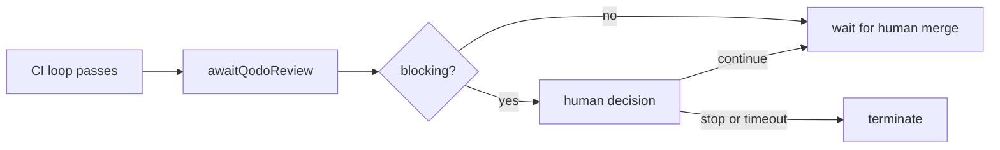

# Qodo follow-ups

Jira: N/A
Date: 2026-10-27
Status: Approved
Last reviewed: 2026-10-27

## Problem

The Qodo integration shipped with four known gaps:

1. An admin can set a Qodo connection's `integration`, `allowedTools` and `scanResults` only through the API. The `/mcp` page cannot show them, and the connection test's Qodo report is not visible.
2. The `/auto-swe fix` command ignores Qodo. A person who asks for a fix does not get Qodo's open findings in the round.
3. `awaitQodoReview` has a worked example in the docs but no built-in template that uses it.
4. The platform explorer narrative says nothing about the Qodo work.

## Approach

One branch, one pull request, four commits, one per gap. Each commit passes every quality gate on its own. The explorer commit refreshes Qodo cards only. It does not run the review attestation, because 21 other commits since the last refresh stay unreviewed.

## Design

### 1. The `/mcp` page (web only)

The list response already carries the policy fields. `redactConnection` removes only the encrypted envelope columns and keeps `config`. So the gateway needs no change.

- `useMcpConnections.ts`: `McpConnectionRow.config` gains `integration?: 'qodo'`, `allowedTools?: string[]` and `scanResults?: boolean`. `McpTestResult` gains `qodo?: { findingsToolAdvertised: boolean; matchedReadTools: number; warning?: string }`. Create and update bodies gain `integration`, `scanResults`. The update body allows `null` to remove a field, as the route does.
- Create and edit modals get two checkboxes: "Qodo integration" and "Screen tool results". The Qodo box forces the screen box on and disabled, because the worker forces screening for a marked connection.
- On edit, the form sends a policy field only when it differs from the stored value. `integration` becomes `'qodo'` or `null`. `scanResults` becomes `true` or `null`. This keeps the audit log free of no-op writes.
- The form never edits `allowedTools`. A marked connection with no stored list uses the worker default, so a copy saved by the form would go stale when the read list changes. When a custom list is stored, the modal shows "Custom tool list: N tools (set through the API)" as text.
- Unchecking the Qodo box shows this warning: removing the marker removes the read-only guard unless a custom list is stored.
- The connection list shows a "Qodo" badge. The test result shows the matched read-tool count, whether `get-pr-review-findings` is advertised, and the warning when present.
- A 400 `QODO_WRITE_TOOLS` response appears through the existing error alert.
- The UI states no tool counts of its own. The count comes from the test result.

### 2. `/auto-swe fix` includes Qodo findings

New setting `qodo.prFeedbackIncludeOnCommand`: boolean, default `false`, group `qodo`, ADMIN, overridable at TEAM and ORGANIZATION, not run-pinned.

In `gatherPrFeedbackImpl`, after the command path builds its human threads, one more step runs when all of these hold:

- the trigger is `command`,
- `qodo.enabled` and `qodo.prFeedbackIncludeOnCommand` are on for the repository's team,
- the PR origin is the platform's own (a command on another origin never reads Qodo).

The step reads Qodo once, with no wait (`waitSeconds` 0). It requires `status` completed and `commitSha` equal to the head. It keeps pending findings at or above `qodo.prFeedbackMinActionLevel`. Any other outcome means the round runs on the human threads alone, and one `pr_feedback.qodo_command_skipped` event records a fixed reason string.

The Qodo brief builder inside `gatherQodoRound` becomes a function both paths call. It does the filtering, one injection-screen batch, fencing, withheld-text handling and bounds. The command path appends its parts after the human threads, with labels that continue from the last human label. Dropped counters add together. The head-SHA recheck runs again before the brief is final, as on the Qodo path.

Decisions:

- No new activity group. A single read takes at most the Qodo read budget (120 s). The shared group allows 10 minutes, so this fits and replay behaviour does not change.
- A command round counts toward `maxRounds` only. It does not count toward `qodo.prFeedbackMaxRounds`, which caps Qodo-triggered rounds. Its dedupe subject stays `pr-N@review-<eventId>`.
- A person triggered the round, so the per-actor access check and the human-author gate still apply to the human threads. Qodo text still passes the injection screen and the fence. It is a tripwire, not a boundary, as `docs/pr-feedback.md` already says.

### 3. Built-in template `ticket-to-merge-qodo`

It is `ticket-to-merge` with one change. When CI passes, it runs `qodoReview()` on the final head, then continues to the merge wait. A blocking review goes to a human decision to continue or stop. Every other status continues. Qodo reviews each push, so waiting for green CI avoids reading a stale review.

- `ticketToMerge.ts` moves its node construction into one exported builder that takes the node the CI loop hands off to. `TICKET_TO_MERGE_SPEC` calls it with the current target. The new spec calls it with `qodoReview`. The existing golden file proves the old spec does not change. Copying about 100 lines was rejected, because the two would drift.
- The new template adds to `BUILTIN_TEMPLATES` (not default, no `inputSchema` change beyond reusing `SWE_INPUT_SCHEMA`), to `builtinTemplates.ts`, to `site/scripts/useCases.mjs`, and as a new `__golden__/ticket-to-merge-qodo.json`. `golden.test.ts` requires a golden for every built-in. The golden is the built spec without presentation fields.
- `docs/workflow-inventory.md` is regenerated with `yarn docs:inventory`.
- With `qodo.enabled` off, the step returns `disabled` at once and the run continues with no wait. The template is safe to list for every team. With it on and no Qodo bot on the repository, each run waits `qodo.reviewWaitSeconds` (default 180 s). The description says so.

### 4. Explorer

Update the cards and shell prose in `site/src/explorer/analysis.json` and `platform-explorer.html` for: the read-only Qodo connection and its screening, the `qodo_findings` trigger, the `awaitQodoReview` step, and the new template. Use source anchors, not docs, as evidence. Run `yarn workspace @auto-swe/site sync` and `yarn vitest run site/scripts`. Do not run `explorer:review`. The "narrative needs review" warning stays on purpose.

## Acceptance Criteria

1. When an admin ticks "Qodo integration" on create, the page shall send `integration: 'qodo'` and `scanResults: true` in the POST body.
2. When an admin edits a connection without touching the Qodo boxes, the page shall send neither `integration` nor `scanResults`.
3. When an admin unticks "Qodo integration" on a marked connection, the page shall send `integration: null` and shall show the guard-removal warning.
4. While "Qodo integration" is ticked, the "Screen tool results" box shall be checked and disabled.
5. When a connection test returns a `qodo` object, the page shall show `matchedReadTools`, the findings-tool flag, and the `warning` text if present. When it returns none, the page shall show no Qodo section.
6. If the route answers 400 `QODO_WRITE_TOOLS`, then the page shall show the message in the form's error alert.
7. When a `command` round runs with `qodo.enabled` and `qodo.prFeedbackIncludeOnCommand` on, on a platform-opened PR, and Qodo's completed review matches the head, the brief shall contain the human threads followed by one `[T<n>]` block per open finding at or above `qodo.prFeedbackMinActionLevel`, numbered after the last human label.
8. If Qodo is unavailable, has no session, is not completed, reviewed another commit, or has no qualifying finding, then the command round shall run on the human threads alone and record one `pr_feedback.qodo_command_skipped` event with a fixed reason.
9. While `qodo.prFeedbackIncludeOnCommand` is off (the default), a command round shall make no Qodo call.
10. If the PR origin is not the platform's, then a command round shall make no Qodo call.
11. If the head moves between the first read and the recheck, then the command round shall drop the Qodo findings and keep the human threads.
12. The `qodo.prFeedbackIncludeOnCommand` definition shall default to `false`, require ADMIN, and allow TEAM and ORGANIZATION overrides.
13. The existing built-in templates shall build to their unchanged golden specs. `ticket-to-merge-qodo` shall have a golden and shall pass `validateSpec`.
14. In `ticket-to-merge-qodo`, when the CI loop passes, the next node shall be `qodoReview`. When the gate sees `blocking == true`, the next node shall be the human decision. Otherwise the next node shall be the merge wait.
15. `site/scripts/useCases.mjs` shall contain an entry for `ticket-to-merge-qodo`, and `yarn workspace @auto-swe/site build` shall pass.
16. The explorer shall contain no claim that conflicts with the Qodo code, and its `reviewedCommit` shall stay unchanged.
17. Each commit shall pass typecheck, the explicit Biome check, the full test suite (apart from the known `workspace.test.ts` timeouts), build, `docs:check`, `invariants:check` and the site build.

## Out of Scope

- Editing `allowedTools` in the web form.
- A wait for a running Qodo review on the command path.
- Counting command rounds toward the Qodo round cap.
- The explorer review attestation, and any prose review of the 21 non-Qodo commits.
- Changing `ticket-to-merge`, its golden, or any replay fixture.
- A live check of Qodo's MCP tool names (needs an API key).

## Risks & Open Questions

- **Resolved:** the web recon said the gateway serializer must change. It does not, because `config` already passes through.
- **Resolved:** no replay risk on the command path. No activity group choice changes.
- **Open, accepted:** after a command round pushes, Qodo re-reviews the new head. The Qodo trigger can then start another round, and the round cap bounds it. Documented in `docs/pr-feedback.md`.
- **Open, accepted:** a command round may include a review that Qodo has not finished. It is skipped, so a person may need to run the command again. Documented.
- **Needs care:** extracting the brief builder touches the Qodo path. The existing Qodo gather tests are the guard. They must pass unchanged.
- **Needs care:** the shared builder in `ticketToMerge.ts` must produce byte-identical nodes. The golden test checks it.
- **Deferred:** the explorer warning remains until someone reviews the other 21 commits.
- Feature flags: the new setting is off by default. The template does nothing without `qodo.enabled`.

## Testing

- Web: `page.test.tsx` cases for acceptance criteria 1 to 6, using the existing `setupFetchMock` pattern.
- Worker: command-path tests in `prFeedback.gather.test.ts` for criteria 7 to 11, using the fake Qodo client. The existing `prFeedback.qodo.gather.test.ts` runs unchanged.
- Shared: `registry.test.ts` for criterion 12. Template tests for 13 and 14. `golden.test.ts`, `validateSpec` and `inventory.test.ts` cover the rest.
- Mutation check: remove each new guard in a scratch copy (the setting check, the origin check, the head recheck, the force-on screening box) and confirm a test fails.
- Docs: update `docs/qodo.md`, `docs/pr-feedback.md` §8 and Limitations, and `docs/workflow-nodes.md`. Remove the two statements that become false: the web form does not show the fields, and `/auto-swe fix` does not consult Qodo.
- Gates: the full set from `CLAUDE.md`. Docker builds are left to CI because no daemon runs locally.
