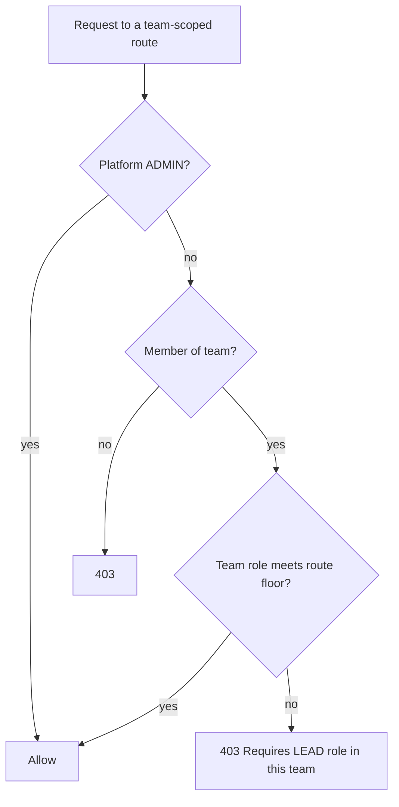
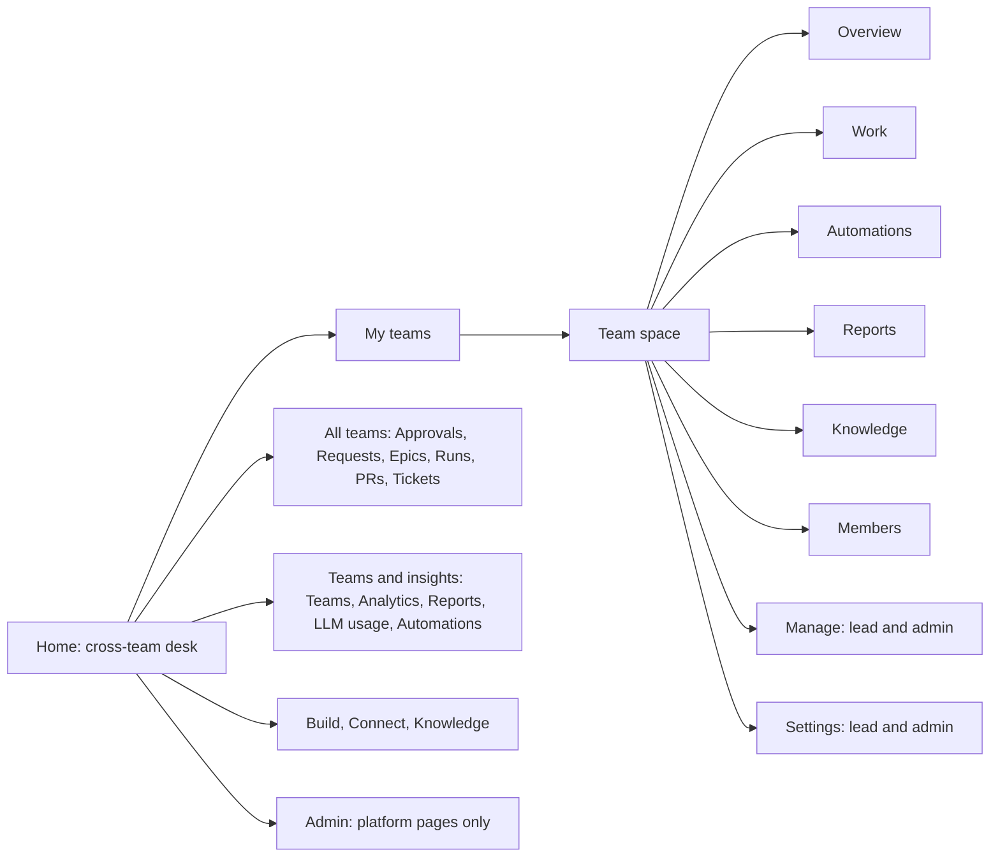

# Team lead and team member UX restructure

Jira: N/A
Date: 2026-11-14
Status: Approved
Last reviewed: 2026-11-14

## Problem

A team lead and a team member use the same dashboard, but the product does not treat them as two
different users. Five problems follow from that.

1. **Two role axes leak into the UI.** The sidebar shows the platform role. The team space shows the
   team role. Team management needs both at once: platform `LEAD` and team `LEAD`
   (`requiredRole: 'LEAD', requiredTeamRole: 'LEAD'` in `routes/teams.ts`, mirrored by
   `teamPermissions()` in the web package). A person who is platform `ENGINEER` and leads a team
   sees a lead badge but cannot add a member, and the UI gives no reason. Some routes already use the
   team role alone (`canManageTeamRepos`, `ledTeams`), so the rule is also inconsistent.
2. **The lead's "Team attention" card cannot be acted on.** It shows three counts. Only "Open pull
   requests" links anywhere. A lead cannot see which failures have no owner, cannot reassign them,
   and cannot nudge an approver whose step is overdue.
3. **A lead has no single place to run the team.** Repositories, schedules, automations, budget and
   service principals sit on Connections, `/admin/schedules`, `/admin/automations` and team
   Settings. The Automations, Reports and Knowledge tabs are link panels. Ordinary team pages (Teams,
   Analytics, Reports, LLM usage, Automations) sit under Admin even though any engineer may open them.
4. **Budget is a dead end for a lead.** A lead sees the meter and a setup-checklist item but cannot
   edit the cap. The only guidance is "ask an admin", with no way to do it in the product.
5. **A member sees a lead view with sections removed.** The team page leads with team statistics. It
   does not lead with the member's own work: needs-you items, running runs, failed runs and pull
   requests that wait for a merge.

## Approach

Make the team role the single authority for every team-scoped action. Reorganize navigation around
teams. Give leads one Manage tab, with actions behind the attention counts. Give every member a "My
work" panel at the top of their team page.

Decisions taken, with the alternatives discarded:

| Decision | Chosen | Discarded |
|---|---|---|
| Role model | Team role alone decides team-scoped actions. Platform `ADMIN` still bypasses. | UI-only relabel; leave as is |
| Platform `LEAD` | Gates only platform-wide pages (Review presets, Platform settings) | Ignore it everywhere |
| Navigation | Team-first | Keep global nav; role-adaptive sidebars |
| Lead controls | New Manage tab | Enrich Settings; shortcut card |
| Member page | "My work" first | Team pulse first |
| Rollout | Flip directly, with an `upgrade-notes.md` entry | Registry-setting gate |
| Delivery | One pull request, commits ordered so the auth change reverts alone | Phased pull requests |

## Design

### 1. Role resolution

- Routes that name a team (`requiredTeamRole` with a team id parameter) set `requiredRole` to
  `ENGINEER` or leave it unset. They no longer repeat `LEAD` at platform level. This covers the
  member and team-edit routes in `routes/teams.ts` and `routes/servicePrincipals.ts`. The plan lists
  every `requiredRole: 'LEAD'` site and classifies each as team-scoped or platform-wide.
- Routes that act on a repository or template resolve the owning team and check the team role. This
  is what `canManageTeamRepos` and `ledTeams` already do. `prdRuns` and the launch helpers move to the
  same helper.
- `/review-presets` and `/admin/platform-settings` stay behind platform `LEAD`, because no team owns
  them.
- Web: `teamPermissions()` drops the platform-`LEAD` conjunction. `canWriteTeamResource()` keeps its
  `ledTeamIds` test and its platform `ADMIN` bypass. A control the caller cannot use stays visible and
  disabled, with a title that names the missing team role. Team pages show only the team role. The
  platform role appears only in the account menu.
- A route test walks the registered routes. It fails when a route has `requiredTeamRole` and a
  `requiredRole` above `ENGINEER`.

### 2. Navigation

- The sidebar order is Home, My teams, All teams (the current Work group, renamed), Teams and
  insights, Build, Connect, Knowledge, Admin.
- Teams, Analytics, Reports, LLM usage and Automations leave Admin and form "Teams and insights".
  They move to `/teams`, `/insights/analytics`, `/insights/reports`, `/insights/usage` and
  `/automations`. Each old `/admin/<page>` address answers a permanent redirect that keeps the query
  string. The plan fixes the exact route map, including `/admin/teams/[id]`.
- The command palette, the product tour anchors (`data-tour="nav:<href>"`) and `detailParent()` read
  the same page map, so they change with it.

### 3. Member page: "My work" first

`GET /api/v1/teams/:id/overview` gains a `mine` block for every viewer level: `running`, `failed` and
`prsAwaitingMerge`, all for the caller on this team's work. The same rules as the desk apply: a
failure counts when the caller launched the latest attempt, or when it is assigned to the caller
(section 5). The Overview renders a "My work" card above the team numbers. The lead panel renders
below it. A repository the caller may launch on carries a **Start work** link.

### 4. Manage tab

The Manage tab shows for a team `LEAD` or `ADMIN` and for a platform `ADMIN`. For everyone else it is
absent and its address answers not found, as Settings does today. Sections:

| Section | Holds | Source |
|---|---|---|
| Attention | The three attention lists with their actions (section 5) | new and existing endpoints |
| Repositories | Owned and shared repositories, shares, launch permission | existing repository routes |
| Schedules, Automations | The team's own, editable | existing routes, narrowed by team |
| Budget | The meter, plus "Request a change" for a lead who cannot edit the cap | section 5 |
| Service principals | Moved here from Settings | existing routes |

Settings keeps configuration: General, Events and agents, Secrets, Sandbox policy, and the Budget
editor for those who may edit the cap. The Automations, Reports and Knowledge tabs stay link panels
for members.

### 5. Actions behind the attention counts

- **Unowned failures.** A new `GET /api/v1/teams/:id/attention/failures` lists them: request title,
  repository, failure time, and the name of the former launcher. A new
  `POST /api/v1/teams/:id/failure-assignments` takes `{ runId, assigneeId }` and stores a
  `FailureAssignment` row. The row never changes `WorkflowRun.launchedById`. That field is a
  credential key, and changing it would run later work under another person's GitHub credential.
  An assigned failure leaves `unownedFailures` and appears as a `failed_run` item for the assignee.
- **Stale approvals.** The lead lists them with the existing `GET /human-steps?overdue=true&teamId=`.
  A new `POST /api/v1/human-steps/:id/nudge` posts a reply in the Slack thread of the step's original
  announcement (`WorkflowHumanStep.slackMessage`), through the existing gateway Slack writer. A new
  `lastNudgedAt` column on the step limits a nudge to one per four hours.
- **Open pull requests.** The count links to the existing list.
- **Budget request.** A new `POST /api/v1/teams/:id/budget-requests` stores a `TeamBudgetRequest`
  with a reason. Team admins and organization admins see pending requests in Settings, Budget. The
  next save of the cap resolves them. No response carries a dollar amount to a non-admin.

Every write above is audited with `writeAuditLog`. Every new route has an entry in
`lib/assistantPolicy.ts`. Assigning, nudging and requesting are `confirm`.

## Acceptance Criteria

**Role resolution**

1. When a user with platform role `ENGINEER` and team role `LEAD` in team T calls `PATCH /api/v1/teams/:id` or any member route for T, the system shall authorize the request instead of returning 403.
2. If a user with platform role `LEAD` and team role `ENGINEER` in team T calls a member route for T, then the system shall return HTTP 403 with the message `Requires LEAD role in this team`.
3. When a platform `ADMIN` who is not a member of T calls a team-scoped route for T, the system shall authorize the request.
4. If a team `LEAD` grants a team role above their own, then the system shall return HTTP 403 with code `PRIVILEGE_ESCALATION`.
5. The system shall require platform role `LEAD` for `/review-presets` and `/admin/platform-settings` and for no team-scoped route.
6. The route test shall fail when any registered route sets `requiredTeamRole` and a `requiredRole` above `ENGINEER`, except the two sandbox allowlist routes that are platform `ADMIN` only by design.
7. `teamPermissions('ENGINEER', 'LEAD')` shall return `canManageMembers: true` and `grantableRoles` equal to `['ENGINEER', 'LEAD']`.
8. `teamPermissions('LEAD', 'ENGINEER')` shall return `canManageMembers: false` and an empty `grantableRoles`.
9. While a control is disabled for a missing team role, the system shall set its title to `Requires the LEAD role in this team` (or the role it needs).
10. `docs/upgrade-notes.md` shall hold one entry that names both affected groups (platform `ENGINEER` team leads gain access; platform `LEAD` team engineers lose it) and gives a query that lists them.

**Navigation**

11. The sidebar shall list groups in the order Home, My teams, All teams, Teams and insights, Build, Connect, Knowledge, Admin.
12. While the caller is platform `ENGINEER`, the Admin entry shall be absent when no Admin page remains visible to them.
13. When a browser requests `/admin/analytics`, `/admin/reports`, `/admin/usage`, `/admin/automations` or `/admin/teams`, the system shall answer HTTP 308 to the new address with the query string intact.
14. The command palette shall offer exactly the pages the sidebar offers.

**Member page**

15. The team overview response shall contain `mine.running`, `mine.failed` and `mine.prsAwaitingMerge` for every viewer level, each counting only the caller's items.
16. The Overview shall render "My work" before "Team numbers" and before the lead panel.
17. While `repo.canLaunch` is true, the repository row shall show a **Start work** link; while it is false, the row shall show the View only badge and no link.

**Manage tab**

18. While the caller's team role is `ENGINEER`, the Manage tab shall be absent and `/teams/<slug>/manage` shall answer the not-found page.
19. While the caller's team role is `LEAD` or `ADMIN`, or the caller is platform `ADMIN`, the Manage tab shall show Attention, Repositories, Schedules, Automations, Budget and Service principals.

**Attention actions**

20. When a team `LEAD` posts `{ runId, assigneeId }` for a failed run whose launcher left the team, the system shall create a `FailureAssignment`, leave `WorkflowRun.launchedById` unchanged, and return HTTP 201.
21. If the run is not an unowned failure of the team's work, then the system shall return HTTP 409 with code `NOT_UNOWNED_FAILURE`.
22. If `assigneeId` is not a member of the owning team, then the system shall return HTTP 422 with code `ASSIGNEE_NOT_MEMBER`.
23. When a failure is assigned, the system shall remove it from `lead.unownedFailures` and add a `failed_run` item to the assignee's Needs you list.
24. When a team `LEAD` of the owning team nudges an overdue, pending step that has a stored Slack message, the system shall post one thread reply and set `lastNudgedAt`.
25. If the same step was nudged less than four hours ago, then the system shall return HTTP 429 with code `NUDGE_RATE_LIMITED` and post nothing.
26. If the step has no stored Slack message, then the system shall return HTTP 409 with code `NUDGE_UNAVAILABLE`.
27. The nudge text shall contain no Slack broadcast mention and shall pass the step title through `escapeSlackMrkdwn`.
28. When a team `LEAD` who cannot edit the cap posts a budget request with a reason of 1 to 500 characters, the system shall store it as pending and return HTTP 201 without any amount.
29. If a pending request exists for the team, then the system shall return HTTP 409 with code `REQUEST_PENDING`.
30. When an admin saves the team's cap, the system shall resolve its pending requests.
31. When a user who is not a team `LEAD` or `ADMIN` calls any new route, the system shall return HTTP 403.
32. The system shall write an audit entry for every assignment, nudge and budget request.
33. `assistantPolicy.test.ts` shall pass with an entry for every new route.

## Out of Scope

- Platform `ADMIN` semantics, organization roles, and the organization budget flow.
- An in-app notification center. Nudges and budget requests use Slack and stored records only.
- Slack direct messages to approvers. A nudge is a thread reply.
- A per-member workload dashboard for leads.
- Embedding the global Automations, Reports and Knowledge pages inside member tabs.
- Changing which identity a run uses for credentials. `launchedById` stays as it is.
- Removing the platform `LEAD` enum value.

## Risks & Open Questions

- **One pull request is large.** It changes authorization, adds two tables and one column, adds five
  routes, moves pages, and redesigns two screens. *Deferred.* The plan orders commits so that the role
  change, the navigation move and each new feature can each be reverted alone. The reviewer should
  note that a phased delivery was the recommended option.
- **Privilege change on deploy.** Team leads with platform role `ENGINEER` gain power at once. Some
  platform `LEAD` users lose it. *Resolved:* flip directly with the upgrade note (criterion 10). No
  feature flag, by choice. A high blast radius still argues for flagging, so this is an explicit
  trade for a simpler code path.
- **Reassignment and credentials.** *Resolved:* `FailureAssignment` is separate from `launchedById`.
  The per-user GitHub credential rules in `CLAUDE.md` stay intact.
- **Nudge reach.** A nudge works only when the worker stored a Slack message for the step. A step
  announced nowhere cannot be nudged. *Deferred:* an in-app reminder for that case.
- **Approver resolution.** The reply goes to the thread, not to named people. *Needs spike:* check
  whether the announcement already mentions the approvers, so that the reply reaches them.
- **Route moves.** Bookmarks, the product tour, `docs/` links, the site manifest and the explorer may
  name `/admin/<page>`. *Needs spike:* grep for every reference. `yarn docs:check` and the site build
  must stay green.
- **Migrations.** Schema changes need the `prisma-pgvector-hnsw` skill before any `migrate` command.
  Any new `*.pg.test.ts` must be named on a `yarn test` line of `ci.yml` (source invariant).

## Testing

- **Unit (web):** `teamPermissions`, `canWriteTeamResource`, `visibleNavGroups`, the redirect map,
  "My work" and Manage rendering for each viewer level, disabled-control titles.
- **Route tests (`app.inject()`):** the role matrix of criteria 1 to 5 and 31; the route-walk test of
  criterion 6; each new route with its error codes; audit rows; `assistantPolicy.test.ts`.
- **Database (`*.pg.test.ts`, flag set as `ci.yml` does):** the unowned-failure query with and without
  an assignment, the `mine` counts, nudge rate limiting, the pending-request uniqueness rule.
- **Existing suites:** the team overview, desk and `meSummary` tests change to the new response shape.
- **Gates:** every gate in `CLAUDE.md` §5, including the site build and the three Docker builds, run
  from a path outside `.claude/worktrees` or with explicit directories for Biome.
- **Manual:** open the app as three users: platform `ENGINEER` + team `LEAD`, platform `LEAD` + team
  `ENGINEER`, and a plain member. Walk Overview, Manage, a redirect, and an assignment.
- **Docs:** update `docs/teams.md` (desk, overview, Manage tab, role rule, Limitations) and
  `docs/upgrade-notes.md`; run `yarn docs:check`.
